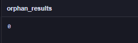
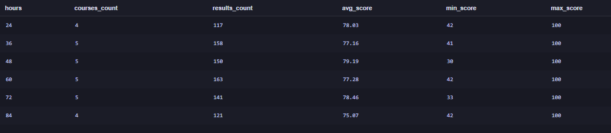
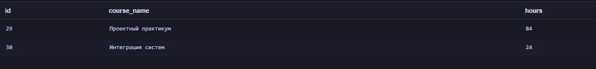

Проверка: в результате LEFT JOIN присутствуют все 15 преподавателей (COUNT(DISTINCT t.id) равно 15).

Почему строк в третьем запросе больше 15: результат содержит 30 строк, потому что за каждым преподавателем закреплено по два курса, и преподаватель повторяется по одной строке на каждый курс. Если бы у преподавателя не было курсов, он всё равно остался бы в выводе, а поле course_name было бы равно NULL. В этой базе таких преподавателей нет.

Разница между INNER JOIN и LEFT JOIN: INNER JOIN возвращает только строки, для которых нашлось соответствие в обеих таблицах. LEFT JOIN сохраняет все строки левой таблицы, а если соответствия справа нет, подставляет NULL.

Вывод: INNER JOIN выводит только совпавшие записи, а LEFT JOIN сохраняет строки левой таблицы даже при отсутствии соответствий.

---

## Шаг 6. Проверка корректности данных

Проверка оценок. Проверяем, нет ли результатов с оценкой меньше 0, больше 100 или отсутствующей.

SELECT COUNT(*) AS invalid_scores
FROM results
WHERE score < 0 OR score > 100 OR score IS NULL;
Результат:

Проверка связей. Проверяем, нет ли результатов, ссылающихся на несуществующую запись на курс.

SELECT COUNT(*) AS orphan_results
FROM results AS r
LEFT JOIN enrollments AS e ON e.id = r.enrollment_id
WHERE e.id IS NULL;
Результат:

| Проверка | Ожидаемое значение | Полученное значение | Итог |
|---|---|---|---|
| Некорректные оценки (invalid_scores) | 0 | 0 | пройдена |
| Оценки без записи на курс (orphan_results) | 0 | 0 | пройдена |

Вывод: оба запроса вернули 0. В рамках проведённых проверок нарушений не обнаружено: все оценки лежат в диапазоне 0–100, и каждая оценка привязана к существующей записи на курс. Это не означает, что проверены абсолютно все возможные ошибки в данных.

---

## Шаг 7. Индивидуальное аналитическое исследование

Вариант: 8.

Исследовательский вопрос: как соотносятся продолжительность курса (hours) и средняя оценка? Сопоставьте курсы разной продолжительности.

Используемые таблицы: courses, enrollments, results.

Ключи соединения: enrollments.course_id = courses.id и results.enrollment_id = enrollments.id.

Показатели: средняя оценка AVG(score), число оценок COUNT(results.id), минимальная и максимальная оценка.

Метод исследования: с помощью INNER JOIN связываем курсы с оценками, группируем по курсу и по длительности курса (GROUP BY) и сравниваем средние оценки. Дополнительно проверяем, есть ли курсы без оценок.

Для ответа на вопрос выполняются два основных запроса и один проверочный.

Средняя оценка по каждому курсу. Для каждого курса считаем число оценок и среднюю оценку, курсы отсортированы по убыванию длительности, затем по средней оценке.

SELECT c.id, c.course_name, c.hours,
       COUNT(r.id) AS results_count,
       ROUND(AVG(r.score), 2) AS avg_score
FROM courses AS c
INNER JOIN enrollments AS e ON e.course_id = c.id
INNER JOIN results AS r ON r.enrollment_id = e.id
GROUP BY c.id, c.course_name, c.hours
ORDER BY c.hours DESC, avg_score DESC;
Результат (первая часть, курсы от 84 до 60 часов):

Результат (вторая часть, курсы от 48 до 24 часов):

Пояснение: в результате 28 курсов, у которых есть хотя бы одна оценка. Внутри одной длительности средние оценки разных курсов сильно различаются. Например, среди курсов по 84 часа «Компьютерные сети» имеют 80.68, а «Разработка API» только 69.87 (разница почти 11 баллов). Самая высокая средняя оценка у курса «Машинное обучение» (48 часов, 83.96), самая низкая у «Разработки API» (84 часа, 69.87).

Сопоставление курсов разной длительности. Группируем курсы по числу часов и считаем показатели по каждой группе.

SELECT c.hours,
       COUNT(DISTINCT c.id) AS courses_count,
       COUNT(r.id) AS results_count,
       ROUND(AVG(r.score), 2) AS avg_score,
       MIN(r.score) AS min_score,
       MAX(r.score) AS max_score
FROM courses AS c
INNER JOIN enrollments AS e ON e.course_id = c.id
INNER JOIN results AS r ON r.enrollment_id = e.id
GROUP BY c.hours
ORDER BY c.hours;
Результат:

| Часы | Курсов | Оценок | Средняя оценка | Мин. | Макс. |
|---|---|---|---|---|---|
| 24 | 4 | 117 | 78.03 | 42 | 100 |
| 36 | 5 | 158 | 77.16 | 41 | 100 |
| 48 | 5 | 150 | 79.19 | 30 | 100 |
| 60 | 5 | 163 | 77.28 | 42 | 100 |
| 72 | 5 | 141 | 78.46 | 33 | 100 |
| 84 | 4 | 121 | 75.07 | 42 | 100 |

Пояснение: средняя оценка по группам находится в узком диапазоне от 75.07 до 79.19. Сумма оценок по группам равна 850, что совпадает с числом записей в таблице results.

Проверка: курсы без оценок. Ищем курсы, по которым нет ни одного результата.

SELECT c.id, c.course_name, c.hours
FROM courses AS c
LEFT JOIN enrollments AS e ON e.course_id = c.id
LEFT JOIN results AS r ON r.enrollment_id = e.id
GROUP BY c.id, c.course_name, c.hours
HAVING COUNT(r.id) = 0
ORDER BY c.id;
Результат:

Пояснение: без оценок остались два курса: «Проектный практикум» (84 часа) и «Интеграция систем» (24 часа). Они не попали в первые два запроса, поэтому в группах 24 и 84 часа по 4 курса вместо 5.

Ответ на вопрос: чёткой зависимости между продолжительностью курса и средней оценкой в данных нет. Самая высокая средняя оценка у курсов по 48 часов (79.19), самая низкая у самых длинных курсов по 84 часа (75.07). Курсы по 24 часа (78.03) и по 72 часа (78.46) находятся выше курсов по 36 часов (77.16) и 60 часов (77.28), то есть с ростом числа часов оценка не растёт и не падает последовательно.

Аналитические выводы:

1. Средняя оценка не зависит от длительности курса линейно: разброс между группами составляет около 4 баллов (от 75.07 до 79.19), и зависимость не монотонная.
2. Самые продолжительные курсы (84 часа) показывают самую низкую среднюю оценку (75.07), а лучший результат у курсов средней длительности (48 часов, 79.19).
3. Минимальные оценки во всех группах низкие (30–42), а максимальная везде равна 100, поэтому различия между группами определяются разбросом оценок внутри группы, а не сдвигом всех оценок.
4. Различия между отдельными курсами одной длительности больше, чем различия между группами по длительности: в группе 84 часа средние оценки курсов лежат от 69.87 до 80.68 (почти 11 баллов), в группе 48 часов от 74.74 до 83.96 (около 9 баллов), а между средними оценками самих групп разница всего около 4 баллов. Значит, на оценку сильнее влияет конкретный курс, чем его длительность.
5. Два курса («Проектный практикум» и «Интеграция систем») не имеют ни одной оценки, поэтому в сравнение они не вошли.

Ограничение анализа: оценки есть только у 850 из 1000 записей на курсы, число оценок в группах разное (от 117 до 163), а в группах по 24 и 84 часа по 4 курса вместо 5. Кроме того, средняя оценка не доказывает причинно-следственную связь: на результат могут влиять сложность курса, преподаватель и состав студентов, которые в этом анализе не учитывались.

---

## Итог

В работе изучена структура SQLite-базы из шести связанных таблиц, выполнены запросы с WHERE, ORDER BY, LIMIT, агрегатными функциями, GROUP BY, HAVING, INNER JOIN и LEFT JOIN, проведены проверки корректности данных и индивидуальное исследование связи между длительностью курса и средней оценкой. Чёткой зависимости не обнаружено: средние оценки по группам длительности различаются лишь на несколько баллов, а различия между отдельными курсами внутри одной группы больше.

Ограничения: выводы относятся только к данному учебному набору данных, оценки есть не у всех записей, а средняя оценка не учитывает сложность курса и состав студентов.

---
